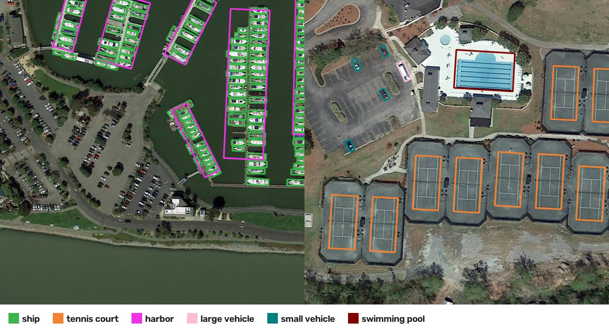
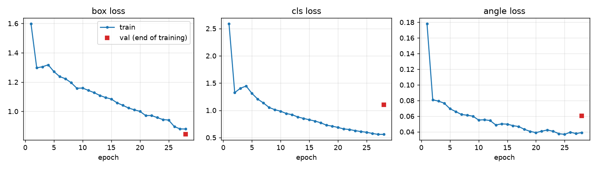

# DOTA oriented object detection

Finds 15 kinds of objects in aerial images (planes, ships, storage tanks, vehicles, sports courts,
bridges, harbours and more) and draws a **rotated** box around each one, so long thin objects such as
ships at a pier or trucks on a diagonal road get a tight box instead of a loose upright one.

Data: [DOTA-v1](https://captain-whu.github.io/DOTA/), 2,806 aerial images up to 4,000 px wide, with
oriented labels for 15 classes.

## Result

Scored on the official DOTA-v1 **val** split, which is never used for training (5,278 tiles,
55,653 labelled objects).

| Metric | Value |
|---|---|
| **mAP50 (oriented boxes)** | **0.818** |
| mAP50-95 | 0.649 |
| Precision / recall | 0.805 / 0.761 |

| Class | AP50 | Class | AP50 |
|---|---|---|---|
| plane | 0.982 | large vehicle | 0.908 |
| ship | 0.974 | small vehicle | 0.830 |
| tennis court | 0.950 | basketball court | 0.820 |
| harbor | 0.890 | ground track field | 0.783 |
| storage tank | 0.882 | roundabout | 0.776 |
| baseball diamond | 0.843 | swimming pool | 0.719 |
| soccer ball field | 0.660 | bridge | 0.633 |
| helicopter | 0.622 | | |

Bridges and helicopters are the weak classes: bridges vary a lot in length and look like roads,
and helicopters are rare in the training data.

The score is computed on 1024 px tiles. The official DOTA benchmark merges tile predictions back
into the full images and is scored on a separate test server, so this number is not directly
comparable to the public leaderboard.

## Method

- **Tiling.** Full images are cut into 1024 px tiles with 200 px overlap
  (`ultralytics.data.split_dota.split_trainval`).
- **Model.** YOLO26-m with an oriented-box head. The backbone starts from COCO-pretrained detection
  weights, not from weights already trained on DOTA, so the score comes from this training run.
- **Augmentation.** Rotations up to 180°, vertical and horizontal flips, mosaic (switched off for the
  last 3 epochs).
- **Training.** 10 hours on a Kaggle GPU (28 epochs), cosine learning-rate schedule fitted to the
  time budget. Validation runs once at the end, on the last checkpoint, so nothing is tuned on the
  val split.

Training loss falls steadily for all 28 epochs. The validation box loss at the end (0.84) is in line
with the training box loss (0.88). The training losses are measured on mosaic-augmented images, so
the two are only roughly comparable.

More plots: [precision-recall curve](results/pr_curve.png),
[confusion matrix](results/confusion_matrix.png). Full numbers: [results/metrics.json](results/metrics.json).

## Run it

All the code is in one notebook, [dota_oriented_detection.ipynb](dota_oriented_detection.ipynb), with an explanation before each step of what it does, why and how it works: download, tiling, training, evaluation and the figures.

Open it on Kaggle, turn on a GPU and internet, and run all cells. No dataset needs attaching: the notebook downloads DOTA-v1 itself. Training is capped at 10 hours to fit Kaggle's 12-hour session.

`results/` has the metrics and plots. The sample-prediction figure uses the 8-tile [DOTA8](https://docs.ultralytics.com/datasets/obb/dota8/) sample.
